  <i>Most portfolios are a list of jobs. Mine is a motorbike ride.</i> 
  <b><a href="https://tanmaysarkar.dev">🏍️ Kick-start it at tanmaysarkar.dev →</a></b>

## 🛣️ Stops along the way

| Stop | When | What happened there |
| --- | --- | --- |
| 🏫 **Malda** | 2019 – 2020 | Kendriya Vidyalaya: PCM + Computer Science. First gear. |
| 🎓 **Gwalior** | 2020 – 2024 | B.Tech ECE at Rustamji Institute of Technology. Circuits by day, backend code after hours. |
| 💼 **Pune** · Solytics Partners | Mar 2023 – Jun 2024 | Backend Developer (Consultant) on an AML SaaS platform. Made the APIs **65% faster** (1.4s → 0.5s) for 10+ international financial orgs. |
| 🚀 **Jaipur** · IzooLogic | Jul 2024 – now | **SDE III**. AI code-security platform with RAG pipelines (**92%** vuln detection), Kafka at **10k+ events/s**, deploys in **under 5 min** to Kubernetes. I lead a team of 5. |
| 🏔️ **Ladakh** | off the clock | Solo rides over Khardung La. Plan the route, pack light, keep going when the road gets rough. |

## ⛽ Pit stop: what's in the tank

  
  
  
  
  
  
  
  
  
  
  
  
  
  
  
  
  
  
  
  

## 🧺 The washing line: side quests

| Project | What it does | Built with |
| --- | --- | --- |
| [**breakyouragent**](https://github.com/Tanmaysarkar2002/Breakyouragentlanginpage) | Crash-test your AI agent: hundreds of jailbreaks, prompt injections and tool-abuse attacks to show exactly where it breaks. | `AI security` `LLMs` |
| [**StatLense**](https://github.com/Tanmaysarkar2002/SentinalLandingPage) | Sentinel, productised. Open-source monitoring for Docker, databases and APIs, with a lightweight Rust agent. | `Rust` `Axum` `React` |
| [**docker-watchdog**](https://github.com/Tanmaysarkar2002/DockerWatchdog) | Real-time Docker monitor. Captures crash logs, auto-restarts containers, and has pluggable Slack/Kafka notifiers. | `Rust` `Docker` `async` |
| [**Data Harvester**](https://github.com/Tanmaysarkar2002/Universal-Scrapper) | Universal web scraper with CAPTCHA solving, Google News and RSS aggregation. Runs on AWS EC2. | `Django` `React` `AWS` |

## 🏆 Achievements

<b>🔒 Hidden achievements on tanmaysarkar.dev (spoilers)</b>

 

- 🐄 **Cow whisperer:** honk while the cow is mooing.
- 🎒 **Back to school:** ride backwards past the school.
- 💻 **Root access:** type `sudo ride` for eight seconds of turbo.
- 🌙 **Moonlighter:** click the moon at night.
- 💭 **Deep thoughts:** stop long enough for the rider to think.

> 🪧 *"Talk is cheap. Show me the code."* (Linus Torvalds, on a wooden board somewhere past Jaipur)

## ☕ Chai stop

  
  
  
  
  

Fun fact: I deploy to prod on Fridays, and sleep just fine (most of the time).

